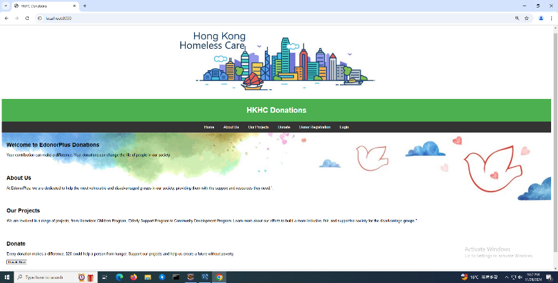
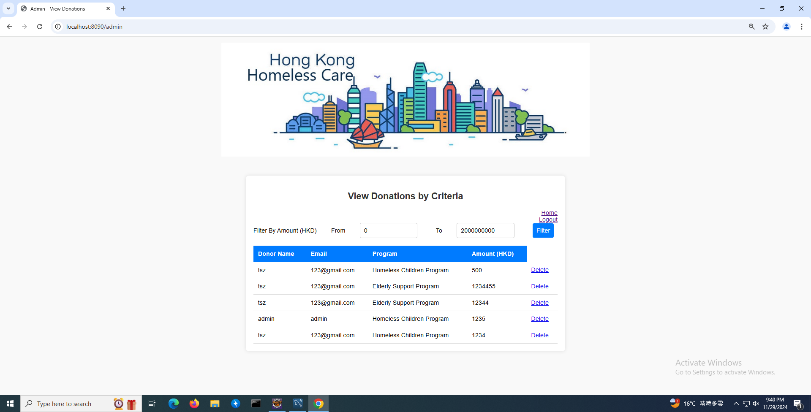
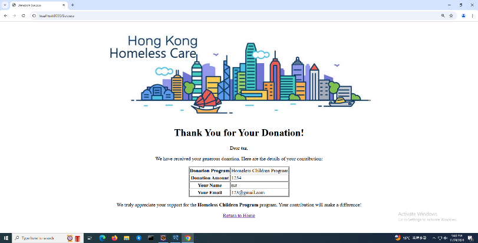
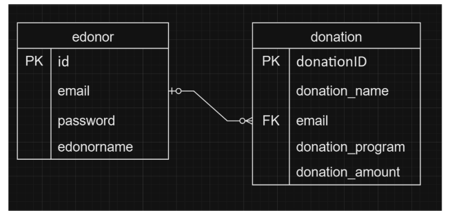

# Donation Management System (eDonor)

Team project for SEHS4701 Advanced Information Systems Development. A Spring Boot + MySQL web application that lets Hong Kong Homeless Care (HKHC), a non-profit helping homeless people in Hong Kong, collect donations online.

Donation programs: Homeless Children Program, Elderly Support Program, Community Development Program.

## Features
- Donor registration and login; admin login (account email `admin`)
- Donor home page, make a donation (choose program and amount), success page
- Donor donation history (`/user-history`)
- Admin: view/edit/delete donors and donations (`/edonordb`, `/admin`)
- Admin donation filter (requirement 3): by min/max amount, program and donor email, with count and total (`/view-donations`)
- Email confirmation service (Spring Mail)

## Tech stack
Java 21, Spring Boot 3.4 (Web, Data JPA, Mail), JSP/JSTL, MySQL

## Structure
- `spring-boot/` - final Spring Boot app (`edu.sehs4701.edonor`: controller, domain, repository, service; JSP views in `WEB-INF/views`)
- `spring-boot/sql/schema.sql` - MySQL schema (`edonor`, `donation` tables) and admin account seed
- `docs/requirements.pdf` - project specification
- `docs/project-report.docx` - project report
- `docs/user-guide.docx` - setup / user guide
- `docs/screenshots/` - screenshots taken from the project report
- `docs/functional-spec.md` - summary of business rules, DB design, workflow and test cases (written from the code)

## How to run
1. In MySQL run `spring-boot/sql/schema.sql` (creates database `speed`). Change the admin password in the script first. (`spring.jpa.hibernate.ddl-auto=update` will also create the tables if they are missing.)
2. In `spring-boot/src/main/resources/application.properties` set `spring.datasource.password` and the mail settings.
3. `cd spring-boot && mvnw spring-boot:run` (build only: `mvnw -DskipTests package`), then open http://localhost:8090.
## Screenshots

